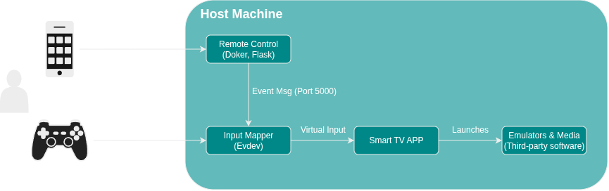

# OmniDeckTV 🎬

**Turn any old laptop or PC into an interactive Smart TV and retro-gaming hub.**


---

## 📌 Overview

After moving to Ireland and needing a complete entertainment solution in a rented room without a physical TV, **OmniDeckTV** was created. It is a lightweight, self-hosted media and entertainment center designed to transform a standard laptop connected to a projector or monitor into a fully functional Smart TV ecosystem.

The system enables users to launch media applications, stream content, and play retro games via emulators using either a smartphone as a touch-based remote control or a physical gamepad.

---

## 🏗️ System Architecture

OmniDeckTV is built using a modular architecture consisting of three core components working in harmony:

1. **Smart TV App (`Tkinter` + `Pillow`)**
   * A Python-based desktop dashboard served as the main user interface on the projector or monitor.
   * Renders media options, app shortcuts, and emulator games smoothly using `Pillow` for image management.

2. **Remote Control (`Flask` + `Docker` + `HTML/CSS`)**
   * A mobile-optimized Web Application packaged inside a lightweight **Docker container**.
   * TV UI generates a dynamic **QR Code** on the top-left corner of the TV UI, allowing any smartphone on the local network to pair instantly without installing additional apps.

3. **Input Mapper (`Evdev`)**
   * A background event listener that receives control signals sent over HTTP/WebSockets from the mobile web remote.
   * Intercepts and interprets native Linux input events from generic gamepads and controllers.




---

## 🚀 Quick Start

### Prerequisites
* **OS:** Linux (Ubuntu/Debian-based recommended)
* **Engine:** Docker & Docker Compose
* **Runtime:** Python 3.8+

### Installation & Execution

To install all dependencies and set up the system environment:
```bash
sudo OmniDeckTV/Scripts/install/install.sh
```

To start all components of CouchHub:
```bash
sudo OmniDeckTV/Scripts/install/run_all.sh
```

To uninstall the application and clean resources:
```bash
sudo OmniDeckTV/Scripts/install/uninstall.sh
```

---

## 🛠️ Development Environment

For development, testing, and container management, helper scripts are provided:

* **Initialize Python Virtual Environment:**
  ```bash
  sudo OmniDeckTV/Scripts/dev/setup.sh
  ```

* **Rebuild Docker Container (Web Remote):**
  ```bash
  sudo OmniDeckTV/Scripts/dev/rebuildContainer.sh
  ```

* **Run Full Suite in Development Mode:**
  ```bash
  sudo OmniDeckTV/Scripts/dev/run_all.sh
  ```

---

## 🛣️ Roadmap & Upcoming Features

- **Dynamic Gamepad Mapping UI:** In-app graphical utility to map generic controller buttons to specific keyboard key.
